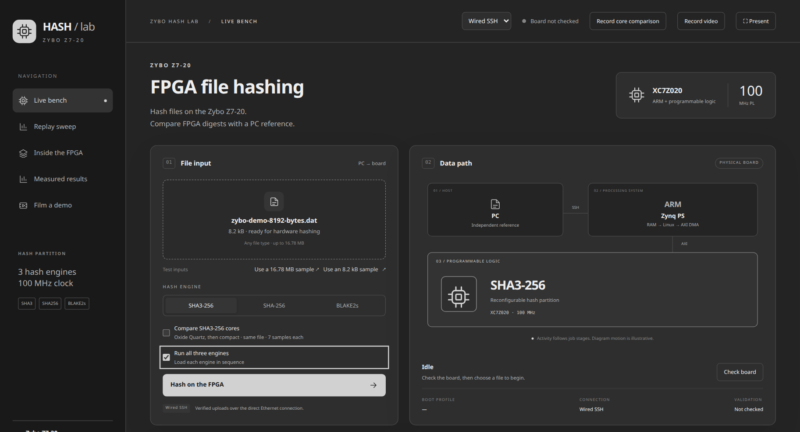
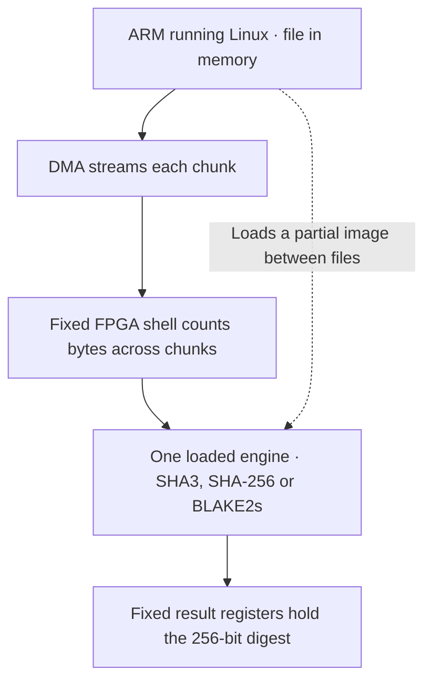

# FPGA DFX Hash Accelerator

**Zybo Hash Lab** lets you send a file to an FPGA, hash it with three different hardware engines, and check each digest against your PC. The algorithms share one region of a Digilent Zybo Z7-20. Dynamic Function eXchange (DFX) replaces the engine between files while the ARM processor, Linux and the rest of the FPGA keep running.

**[Follow the illustrated tutorial](tutorial.md)** · [Open the operator guide](docs/demo.md) · [Explore the hardware design](docs/architecture.md)



## Try it

Run the launcher from the repository root on Ubuntu.

```sh
./dashboard.sh
```

- **On your PC**, open **Inside the FPGA** to step through the SHA3 datapath. **Measured results** opens the saved board measurements. The tutorial also shows how to regenerate the sample bytes and check all three recorded digests with Python. [Start the offline walkthrough](tutorial.md#check-the-recorded-digests-on-your-pc)
- **With a configured Zybo**, open **Live bench**, select the connection and choose **Check board**. Select **Use an 8.2 kB sample**, enable **Run all three engines**, then choose **Hash on the FPGA**. **Export evidence** saves the results as JSON. [Board prerequisites and live walkthrough](tutorial.md#run-the-sample-on-a-zybo)

## One file on three hardware engines

The board hashed the same 8,192 bytes with each engine. SHA3 was already loaded. The next two requests loaded different partial images and produced their own 256-bit digests. All three matched the PC reference for the corresponding algorithm. [Original board receipt](results/demo-20261115/gui-sample.json)

| Engine | On-board hash time | FPGA elapsed cycles | Time to load engine |
| --- | ---: | ---: | ---: |
| SHA3-256 | 505.2 µs | 26,899 | Already loaded |
| SHA-256 | 579.2 µs | 39,491 | 37.735 ms |
| BLAKE2s-256 | 605.5 µs | 41,611 | 37.815 ms |

Each row is one request. For this small file, switching engines took much longer than hashing the bytes. Successive requests for the same loaded engine can skip that load. The on-board timer covers the RAM file read, driver, DMA and core. Upload and reconfiguration are timed separately. [How to read the timers](docs/demo.md#what-the-timing-means)

## How one FPGA runs three algorithms

The ARM processor supplies the message length and fills a reusable 1 MiB memory buffer. Direct memory access (DMA) streams the bytes into a fixed part of the FPGA called the *shell*. The shell counts bytes across transfers, tells the engine when the file ends, and holds the final digest for Linux to read. A file can span many buffers and still produce one digest.



Before a switch, the driver waits for the current file to finish or abort, stops DMA and isolates the partition. It loads a partial image built for that shell and checks the engine identity before accepting another request. [Engine implementations](docs/engines.md) · [Stream framing and register map](docs/architecture.md) · [DFX implementation and image compatibility](docs/dfx.md)

## Other ways to use Hash Lab

| Task | Where to start |
| --- | --- |
| Hash data produced by an ARM application | Call `LocalHasher` with a buffer, file or stream, or use its CLI on the Zybo. [Python and CLI examples](docs/local-ps.md) |
| Hash a file from another machine | The TCP client streams input to the board service and can verify the returned digest. [Client, service and protocol](docs/software.md) |
| Compare two implementations of SHA3 | **Compare SHA3-256 cores** runs the same file on Quartz and compact, checks both digests and reports the median of seven timed requests per core. [Comparison controls](docs/demo.md#compare-the-physical-sha3-256-cores) |
| Measure the FPGA without a host upload | **Replay sweep** feeds a repeating pattern from FPGA block RAM. It measures 25 message sizes from 64 B to 1 GiB at 100 MHz and exports the samples behind the chart. [Replay controls and timing](docs/demo.md#physical-fpga-memory-replay-sweep) |
| Simulate or rebuild the design | Run `./test.sh` for the offline suite or `./build.sh system` for the base three-engine design. [Build guide](docs/build.md) · [Routed and physical verification](results/status.md) |

## Platform and tools

| Task | Tested environment |
| --- | --- |
| Run the dashboard or follow the offline tutorial | Ubuntu 24.04 LTS x86-64, Python 3.11+ and a browser. Live SSH uses OpenSSH. USB UART uses `fuser` from `psmisc`. |
| Hash on hardware | Digilent Zybo Z7-20 (XC7Z020), 100 MHz programmable logic, ARM Linux with the hash DMA driver and a matching set of full and partial images. [Board setup](tutorial.md#run-the-sample-on-a-zybo) |
| Build and simulate | AMD Vivado **2024.2** with Zynq-7000 support and the Digilent board definition. Verilator 5.020 runs the SystemVerilog tests and NVC 1.23.1 runs the VHDL reference. [Setup commands](docs/build.md#ubuntu-2404-simulation-setup) |

Hash Lab also served as the test platform for the **Oxide SHA3 comparison**. The companion project shows what changed between the Quartz and compact cores, with the walkthrough video, FPGA charts and measurements. [Oxide SHA3 comparison](https://github.com/rlongwell/oxide-sha3-comparison-public#fpga-sha3-256-performance-against-oxide-quartz) · [Upstream credits and licenses](THIRD_PARTY_NOTICES.md)
