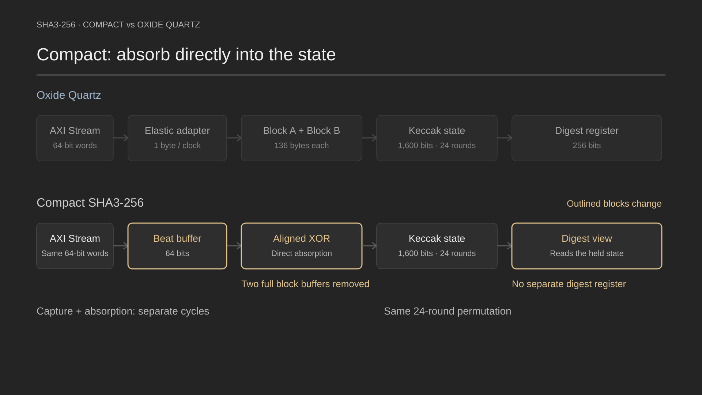

# SHA3-256 architecture comparison

Both integrations accept a common 64-bit AXI Stream interface. The input source
can be the PS/DMA path, the GEM RX buffer reader in PL, or FPGA block RAM replay.
The onboard Ethernet port still uses the PS GEM controller; the diagram does
not imply a direct PHY-to-PL connection. The stream mux is in
[`net_system_top.sv`](../rtl/net/net_system_top.sv), and the network/replay reader
is in [`gem_ingress.sv`](../rtl/net/gem_ingress.sv).

Both implementations perform SHA3-256 with a 1,600-bit Keccak state and a
24-round permutation. The changed blocks are outlined. This diagram describes
the source design; it is not an internal signal trace.

| Part | Oxide Quartz integration | Compact core |
| --- | --- | --- |
| Input | Local elastic adapter converts 64-bit AXI beats to one byte per clock | One 64-bit captured beat |
| Absorption storage | Two 136-byte block registers, with byte-wise fill and padding | Aligned XOR directly into the state; no pair of full block registers |
| Overlap | Next block can fill while the prior block is permuted | Capture and absorption take separate cycles; do not infer one beat per clock |
| Permutation | 24 rounds, one round per clock | 24 rounds, one round per clock |
| Digest | Separate 256-bit digest register | Read the digest from the held state |

The compact core also narrows padding selection to the 17 rate lanes and
registers framing-validation status before the state write-enable path. The
**25-lane selector → 17-lane static decode** comparison describes refinements
from this project's earlier wide core. It is not a claim that Quartz had that
same selector. The standalone 5,664 → 4,498 LUT comparison is likewise a
within-project synthesis result, separate from the routed Quartz comparison.

Source mapping:

- [Unchanged Quartz VHDL](../reference/oxide/hdl/ip/vhd/sha3/sha3_256.vhd):
  feed FSM, alternating block registers, permutation FSM and `perm_reg.dig`.
- [Local elastic byte adapter](../rtl/sha3/oxide_compare/axis_bytes_elastic.sv):
  full-rate input adapter used in the reference integration.
- [Compact SystemVerilog](../rtl/sha3/experiments/hash_sha3_compact.sv):
  `buffer_data`, direct absorption, padding decode, registered framing checks,
  and digest assignments from state lanes.
- [Physical benchmark and routed resource report](../results/sha3-performance-20261115/comparison.md):
  5,856 → 4,531 routed partition LUTs and 4,222 → 1,774 flip-flops, including
  each partition's local adapters. Both use zero BRAM and DSP.

Credit belongs to **Oxide Computer Company and Quartz contributors**, including
nathanaelhuffman's SHA3 work in [Quartz PR #516](https://github.com/oxidecomputer/quartz/pull/516).
The reference is pinned to `c0ccf08525f30c43f4c773c2295dabe80f97cd0e`; its
source and MPL-2.0 license are retained. The project was developed with AI
assistance. This is a workload-specific Zybo integration comparison, without
Oxide endorsement or a claim about performance in Oxide production systems.

The [narrated demo](demo-architecture-video.md) explains these blocks as they
appear, then shows the same 16.78 MB file through both physical cores.

The [updated full demo](demo-stream-video.md) presents padding and input validation
as separate before/after scenes. All 25 state lanes remain present. Only padding
selection is restricted to the 17 rate lanes; the permutation still uses all 25.
Framing validation records a fault while capturing the input, then prevents an
invalid buffered word from being absorbed on the following cycle.
