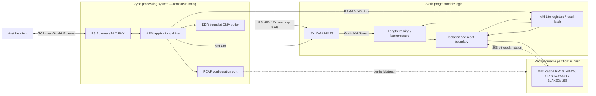

# Hardware architecture

## Target and dependencies

Target the Zybo Z7-20, `xc7z020clg400-1`, with Vivado **2024.2**. The installed Digilent board definition is `digilentinc.com:zybo-z7-20:part0:1.2`. Use its PS7 preset for DDR and MIO; do not reproduce those timing parameters by hand. The board has 1 GiB of 32-bit DDR. Ethernet0 uses PS MIO16–27 and MDIO uses MIO52–53. Ethernet is a PS peripheral, not a PL MAC connected to the onboard PHY.

Required vendor IP: processing_system7, AXI DMA (MM2S only), AXI interconnect, and processor system reset. A static RTL shell handles stream framing, control, result capture, and isolation. Dedicated DFX IP is optional: isolation implemented in static RTL must clamp **every** partition output and prevent new input handshakes, with tests and implementation checks. PCAP is controlled by PS software; it is not an AXI stream endpoint in PL.

The diagram below follows a TCP request. The browser dashboard transfers the file over SSH or USB UART, then calls the local ARM API. Both paths use the same DDR buffer, DMA and reconfigurable hash engine. The extended shell also supports [FPGA memory replay and direct packet input](gem-direct.md).

## Block diagram

DFX means separate implemented configurations and partial bitstreams. There is no run-time algorithm selection multiplexer in the hardware. Simulation may instantiate each RM separately or replace a model at the same boundary; that alone is not evidence of functioning DFX.

[Detailed TCP and DMA block diagram](assets/architecture.svg)

## Hierarchy and ownership

`system_top` contains a generated `ps_dma` block-design wrapper, `hash_shell` static RTL, and the hierarchical cell `u_hash`. Each configuration resolves `u_hash` to exactly one `hash_rm` implementation. Out-of-context RM checkpoints share the same ports. The static routed design is locked and reused when implementing the remaining RMs; `pr_verify` checks compatibility before partial bitstreams are accepted.

Static logic owns register state, file length, transferred byte count, digest readback, DMA framing, interrupts, isolation, and reset. The RP owns all algorithm state, block/padding state, the compression/permutation datapath, and a constant algorithm ID. A partition reset aborts and discards a file. State migration between algorithms is outside this design.

Floorplanning must use legal 7-series clock-region/column boundaries, sufficient slices for the largest measured RM, and routed timing at the requested clock. A pblock is selected from actual device resources and tested in implementation. `HD.RECONFIGURABLE`, `RESET_AFTER_RECONFIG`, and routing containment are applied using the supported Vivado DFX flow. Placement alone does not establish DFX validity.

## Common partition interface

| Signal | Direction at RP | Meaning |
| --- | --- | --- |
| `aclk`, `aresetn` | input | One common clock; active-low partition reset |
| `start` | input | One-cycle new-message pulse, accepted only when idle |
| `message_length[63:0]` | input | Byte length sampled with start |
| `s_axis_tdata[63:0]` | input | Earliest byte in bits 7:0 |
| `s_axis_tkeep[7:0]` | input | Nonzero contiguous low-byte mask on a valid beat |
| `s_axis_tvalid`, `s_axis_tlast` | input | Valid beat; last marks the final **file** beat |
| `s_axis_tready` | output | Accept only on ready AND valid |
| `busy` | output | A message is in progress, including padding/compression |
| `digest[255:0]`, `digest_valid` | output | Byte 0 of conventional digest in bits 7:0 |
| `digest_ready` | input | Result acceptance; valid and data remain stable until accepted |
| `algorithm_id[31:0]` | output | 1 = SHA3-256; 2 = SHA-256; 3 = BLAKE2s-256 |
| `error` | output | Sticky protocol error until reset/new start |

Start with length zero triggers algorithm-specific empty-message finalization without an AXI stream beat. Start clears previous per-message status; a result waiting for acceptance prevents another start. SHA-256 supports byte lengths through `2^61-1` because its padding has a 64-bit bit count; software rejects larger lengths. The common length interface supports streaming and does not require a complete file in memory.

The implemented interface and byte adapter are fixed at 64 bits; they do not currently expose a width parameter. All compiled RMs in one DFX build must have identical port widths, and this release validates one physical partition ABI rather than untested width combinations. An AXI Stream width converter outside the partition permits integration with other bus widths without changing that ABI. Parameterizing the standalone adapter and core ports is deferred until there is a second width to verify; changing the partition width requires rebuilding every configuration. A simple one-beat elastic buffer with byte serialization provides a correctness-first implementation for byte-input cores. Wide direct absorption is measured separately, since a wide wrapper does not by itself make a byte core faster.

The core must validate length/final-beat consistency. Once a beat is offered, a sender holds data, keep, last, and valid unchanged until acceptance. Digest data is likewise stable under result backpressure. All state changes use a single clock domain.

## Static framing and DMA

Software writes the total file length then starts the shell. The shell tracks accepted bytes, rejects malformed keep masks or a beat larger than the remaining length, and derives RP TLAST from the byte count. **DMA TLAST is only a chunk boundary and never causes hash finalization.** Low contiguous partial keeps are supported at arbitrary chunk boundaries, including a chunk ending inside an algorithm block.

Accepted and remaining counts are registered separately. This keeps the 64-bit length subtraction out of the combinational stream path across the partition boundary. The initial subtraction-based path missed routed timing; the counter version preserves protocol behavior and was reverified with all three engines.

Use AXI DMA simple mode initially, MM2S only, with 64-bit stream width, a 32-bit address space, data realignment enabled, and sufficient transfer-length width. Software fills one driver-managed 1 MiB coherent DDR buffer, submits the transfer, waits for DMA completion, then receives the next chunk into the same buffer. This bounds memory use independently of file size. Receive/DMA overlap with a buffer pool is a future throughput improvement, not part of the current measurement assumptions. Cache maintenance and DMA mapping are the responsibility of the PS driver, not guessed physical addresses in an unprivileged Python process.

DMA completion means that chunk has left DMA; hash completion is independent and occurs after padding/compression. A stalled TCP receive pauses DMA submission without losing hash state. Timeouts abort the file, reset DMA as required, and reset the partition before accepting another file. Software must never reuse a DMA source buffer while the transfer is active.

## Register map

The hash shell occupies a 4 KiB AXI Lite aperture at `0x43C00000`. The DMA register base is `0x40400000`. See the [implemented address map](dfx.md#psdma-static-design) and [shell RTL](../rtl/static/hash_shell.sv). Registers are 32-bit little endian. Digest byte order matches the stream convention: the first eight conventional hex characters are the little-endian bytes of DIGEST0.

| Offset | Name | Access | Definition |
| --- | --- | --- | --- |
| `0x00` | CONTROL | RW / pulses | bit0 START pulse; bit1 ABORT pulse; bit2 ISOLATE retained; bit3 CLEAR_STATUS pulse |
| `0x04` | STATUS | RO | bit0 BUSY; bit1 DONE sticky; bit2 ERROR sticky; bit3 ISOLATED; bit4 ENGINE_READY |
| `0x08` | ALGORITHM | RO | Active ID; zero while isolated |
| `0x0C` | VERSION | RO | Register/partition ABI version |
| `0x10` | LENGTH_LO | RW | Total file byte count bits31:0; changes rejected while busy |
| `0x14` | LENGTH_HI | RW | Total file byte count bits63:32 |
| `0x18` | ACCEPTED_LO | RO | Bytes accepted in current file bits31:0 |
| `0x1C` | ACCEPTED_HI | RO | Bytes accepted bits63:32 |
| `0x20–0x3C` | DIGEST0–7 | RO | Stable static result latch, cleared on new start |
| `0x40` | CYCLES_LO | RO | PL cycles from accepted start through result capture |
| `0x44` | CYCLES_HI | RO | Cycle counter bits63:32 |
| `0x48` | ERROR_CODE | RO | Protocol / control / engine failure reason |

AXI Lite independently accepts address and write data and holds read/write responses until accepted. It honors byte strobes. Invalid offsets/accesses return SLVERR. Polling is sufficient initially; a completion/error interrupt also connects to the PS fabric IRQ. Every CONTROL write with the low-byte strobe enabled replaces ISOLATE with bit2 of that write; the other control bits are pulses. Write `0x0C` to clear status while keeping isolation, or `0x08` to clear status and release isolation. Software must include the intended bit2 value on every such write.

## Clocking, reset, and reconfiguration

Initial target: PS FCLK_CLK0 at 100 MHz for DMA, interconnect, shell, and RP. Use `proc_sys_reset` with the PS fabric reset and clock-lock inputs. All PL AXI paths share this clock, avoiding extra clock-domain crossings. Board clocks, DDR timing, and MIO are provided by the PS preset.

Global reset clears static state and initially isolates the RP. Partition reset is asserted while isolated and held through a documented release delay after configuration. Isolation clamps stream valid/start/digest-ready into the RP and ready/busy/digest-valid/error/ID from the RP. Software-visible idle under isolation cannot mean an in-flight message completed: quiescence and abort are explicit shell states/status.

Switch only between files: stop accepting new requests, finish or abort the active file, stop/reset outstanding DMA, assert isolation, check isolation status, load the compatible partial image through the PS configuration mechanism, keep reset asserted, release isolation, verify algorithm ID/readiness, then resume transfers. On load failure remain isolated. Ethernet and ARM execution stay in the static PS. A new full FPGA image requires a fresh compatible set of partial images; never mix builds.

## Verification and measurement

Use Python hashlib for SHA3-256, SHA-256 and unkeyed 32-byte BLAKE2s vectors. Validate empty, single byte, small, boundary±1, 135/136/137, long and deterministic random messages. Test independent input stalls, output backpressure, repeated messages, abort/reset mid-block, variable DMA splits, bad keeps/lengths, and isolation with deliberately toggling RP outputs. Ordered, dropped, duplicated, and reordered payloads have separately computed expected digests.

First validate and synthesize the unchanged Oxide baseline. Its stream cannot represent an empty message; record that limitation and test any empty-message adapter separately rather than claiming a native baseline test. Any tool compatibility adaptation must be outside the immutable upstream directory and disclosed, with semantic equivalence checked.

Core timing/resource comparisons use the same part, Vivado version, clock, flattening and synthesis options. Record both synthesis estimates and routed implementation results with their scope. Cycle-based core throughput is distinct from raw Keccak rate, DMA performance, and Ethernet performance. The [physical profiling run](review-guide.md) measures DMA/API rates, FPGA Manager duration and ARM hashing separately. The [later Ethernet study](../results/ethernet-20261116/README.md) records external-link measurements. Report x86 software benchmarks with CPU, runtime, message size, repetition count, and dispersion.

## Primary references

- [Digilent Zybo Z7 reference manual](https://digilent.com/reference/_media/reference/programmable-logic/zybo-z7/zybo-z7_rm.pdf)
- [AMD Vivado DFX User Guide UG909, 2024.2](https://docs.amd.com/r/2024.2-English/ug909-vivado-partial-reconfiguration)
- [Oxide Quartz SHA3 implementation](https://github.com/oxidecomputer/quartz/tree/main/hdl/ip/vhd/sha3)
- [FIPS 202: SHA-3](https://doi.org/10.6028/NIST.FIPS.202)
- [FIPS 180-4: SHA-256](https://doi.org/10.6028/NIST.FIPS.180-4)
- [RFC 7693: BLAKE2](https://www.rfc-editor.org/rfc/rfc7693)
