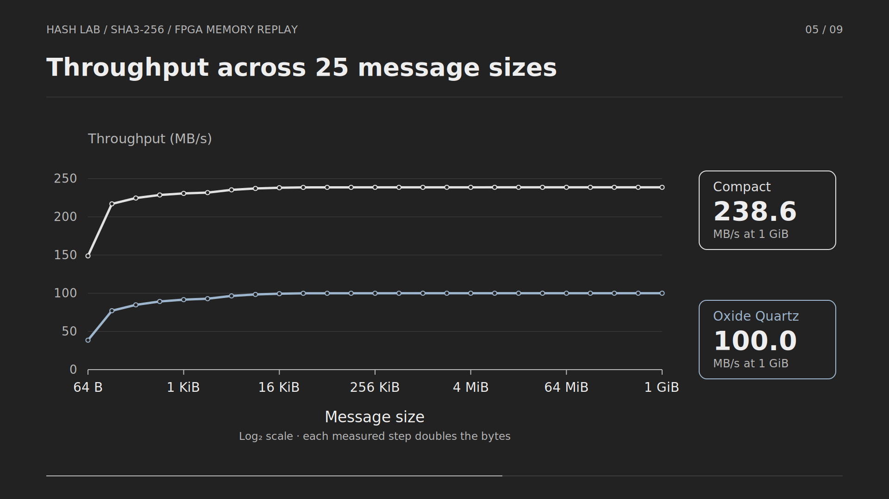

# FPGA block RAM replay video

[Watch the replay edition](media/sha3-comparison-replay.mp4) · [Video evidence](../results/demo-replay-20261116/README.md)

This 2:04.8 charcoal edition explains the physical **SHA3-256** block RAM replay
experiment, comparing the compact core with **Oxide's unchanged Quartz core**.
It is an animated presentation of retained board measurements. The previous
[architecture and live GUI edition](demo-flow-video.md) remains available.

The story follows a 128 KiB deterministic pattern through the FPGA memory
reader, framing and selected hash core. Repeating the pattern preserves one
continuous hash state; the FPGA does not store an entire 1 GiB message. Timing
begins at hardware START and ends when the digest is ready. Loading the pattern,
reconfiguration and software reference hashing happen outside that interval.

The results use 25 doubling sizes from 64 B to 1 GiB, with seven measured trials
per core and size after warmup: **350 measured replay hashes plus 50 warmups**.
The separate Ethernet measurements are not mixed into these charts. At 1 GiB,
Quartz takes 10.73741926 s and compact takes 4.50024163 s: 100.000 versus
238.596 MB/s, or 2.386× throughput. Every digest matched the software reference.



Both the throughput and speedup scenes have their own **Message size** title
and tick labels: **64 B, 1 KiB, 16 KiB, 256 KiB, 4 MiB, 64 MiB, 1 GiB**.
The horizontal scale is logarithmic, base two; MB/s uses decimal megabytes.
The regular size-sweep plotter also now labels every panel's x axis, so a crop
of its throughput panel remains understandable. The old sealed plots have not
been replaced.

Resource figures come from the matching 100 MHz routed build: 5,854 versus
4,572 LUTs and 4,222 versus 1,774 flip-flops in the hash partition. This is
21.90% fewer LUTs and 57.98% fewer flip-flops. The shared replay memory is
separate from those partition counts; the complete shell uses 65 RAMB36 and
one RAMB18 in either configuration. Earlier shell counts are not substituted.

## Narration, music and picture

Two new takes were generated using the existing ElevenLabs **Jarnathan —
Confident and Versatile**, Eleven v4 configuration, with stability 0.62,
similarity 0.75 and clone strength zero. Both original downloads are retained.
Take 2 was selected after word-timed transcription and acoustic phoneme review.
The input spells the algorithm as “shah three, two fifty-six”; both takes
produced the expected /ʃɑː/ sound. A full-pass transcription inserted a stray
word near “measurements”; chapter transcription and the acoustic labels resolve
the source audio as the intended “measurements and scripts.”

The selected take plays continuously, with no added gaps between paragraphs.
Slow level balancing and pitch-preserving 1.06× playback match the prior pace
preference. Scene changes, curve reveals and result bars follow the actual
spoken words. The only looping motion illustrates data on the memory path.
There is no screen recording, browser chrome or pointer in this edition.

**Cyber Runner by 2050 / Artlist** runs throughout. This shorter movie fits
within the original track, so no phrase repeats are needed. The retained onset
analysis identifies a 170 BPM editing grid (85 BPM half-time); the musical
change near 61.23 seconds leads the Quartz throughput reveal, and the change
near 102.54 seconds accompanies the resource section. Speech ducks the music
without muting it. The mix is normalized to −16 LUFS with a −1.5 dBTP ceiling.
The separately licensed music source is not redistributed in the repository.

These are automated transcription, acoustic, signal and visual-frame checks,
not a claim of human listening. The evidence directory retains their results.

## Reproduce

From the repository root, with CairoSVG, NumPy and FFmpeg installed:

```sh
python demo/render_video_replay.py \
  --music '/path/to/2050 - Cyber Runner.mp3' \
  --work build/demo/replay-rebuild \
  --output build/demo/sha3-comparison-replay-rebuild.mp4
```

The renderer verifies SHA-256 hashes for the voice, music, raw measurement
report, computed summary and routed resource report. `--stills-only` exports
the nine complete SVG/PNG scenes without producing a movie. The movie uses
1920×1080 native SVG frames at 30 fps, H.264 picture and AAC audio.

Credit to [Oxide Computer Company and the Quartz contributors](../THIRD_PARTY_NOTICES.md)
for the reference core and prior work. Their pinned source and license remain
unchanged. The project was developed with AI assistance. This local Zynq replay
comparison does not measure Oxide's production SPI-NOR system.
