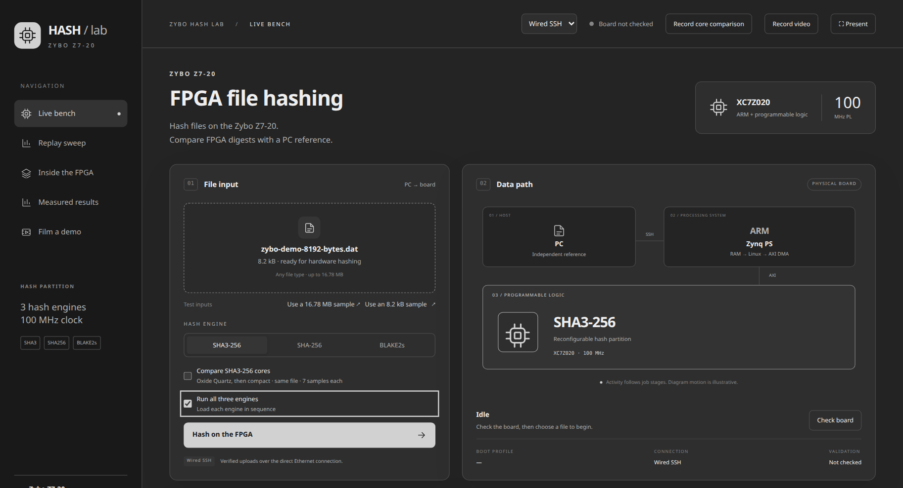
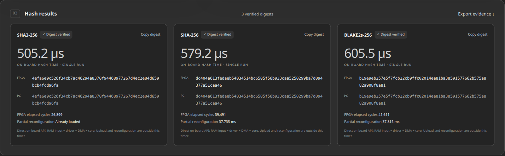
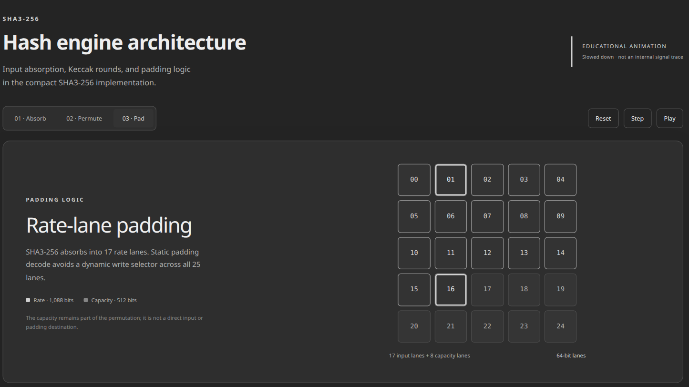

# Zybo Hash Lab

Use the live bench to send a file to the Zybo, switch hash engines, and check the returned digests against a PC reference. Use Replay sweep to measure the FPGA with data supplied by its own block RAM. The [platform overview](../README.md) summarizes a verified three-engine run. The [Oxide SHA3 comparison](https://github.com/rlongwell/oxide-sha3-comparison-public#fpga-sha3-256-performance-against-oxide-quartz) presents the architecture walkthrough and benchmark results.

Launch the PC dashboard from any working directory:

```sh
/path/to/fpga-dfx-hash-accelerator/dashboard.sh
```

It opens `http://127.0.0.1:8765` in your browser. Python 3.11+ and Linux's `fuser`
command are required; SSH connections also need the OpenSSH client and the configured host aliases. The application otherwise uses the Python standard library,
local HTML/CSS/JavaScript, and system fonts. It downloads no web assets or packages.
Use `--no-browser` or `--port 8766` when needed. Keep the launcher terminal open.

For a first session, follow the [illustrated tutorial](../tutorial.md). It includes a PC-only digest check, a physical board run and a two-transfer file.

## Live file hashing



1. Power the Zybo and connect its J12 USB JTAG/UART cable. Boot the shared card's
   `hash` profile and leave the installed hash service running.
2. Select **Wired SSH** (the default), **Wi-Fi SSH**, or **USB UART**.
   SSH uses the existing `zybo-wired` / `zybo-wifi` host aliases with key-only
   authentication and strict pinned host-key checks. This dashboard does not
   create network settings or credentials. For UART, close any serial terminal
   that owns it; the dashboard never takes over an existing owner.
3. Click **Check board**. This verifies the board model, kernel, installed full
   image/manifest, and installed software against the validated project files.
   The badge records the last successful check; it is not continuous monitoring.
4. Select a file or **Use an 8.2 kB sample** (8 KiB), choose an algorithm, and click
   **Hash on the FPGA**. **Run all three engines** demonstrates real switching.
5. Compare the FPGA and independent PC digests, then **Export evidence** to save
   the complete JSON receipt.

The file travels over the selected SSH connection or 115200-baud USB UART to a unique `/tmp` file
in board RAM. A separate SHA-256 check validates that transfer. The bridge then
pauses the TCP service, opens the existing `LocalHasher` API and performs real
DMA hashing. It verifies an empty SHA3 digest when restoring the compact engine,
closes its device handle and restarts the service. The final board check confirms
the service is running again. Neither the installed FPGA assets nor the boot
profile selection is replaced. Temporary payloads and helpers are removed.

Files are limited to 16 MiB (16.78 decimal MB) to bound temporary memory and transfer duration.
UART is slow: use the 8 KiB sample for a short demonstration. A 1 MiB file takes
roughly a minute and a half to transmit. Transfer progress is displayed, but
upload speed is not a performance metric in the GUI.

### Connection troubleshooting

| What you see | What to check |
| --- | --- |
| Browser cannot open the dashboard | Keep the launcher terminal open and use the local address printed there. If the default port is occupied, run `./dashboard.sh --port 8766`. |
| Wired or Wi-Fi SSH fails before the probe | Select the alias for the physical connection. From the same PC, try `ssh -o BatchMode=yes -o StrictHostKeyChecking=yes zybo-wired true` (or `zybo-wifi`). Verify the board address, key login and pinned host key for that alias. |
| UART disconnected or already in use | Connect J12, inspect `ls -l /dev/serial/by-id/` and close any serial terminal using the board. The reference bench selects its Digilent UART by serial ID in [the UART bridge](../demo/uart.py). Another board can use configured SSH or needs its own port selection there. |
| Board reachable but image or software differs | Read the failed check. Compare the booted profile, full image, partial-image manifest and installed software with the [dashboard manifest](../demo/board_manifest.json) and [probe checks](../demo/server.py). Use a matched image set. |
| A replay sweep cannot start | Select an SSH transport. Replay needs the extended static shell, compatible images and matching local board helper. See the [replay build instructions](gem-direct.md#rebuild-and-reproduce). |

### Compare the physical SHA3-256 cores

Choose **Use a 16.78 MB sample**, check **Compare SHA3-256 cores**, then click
**Compare on the FPGA**. Any nonempty file within the size limit also works.
The pinned upstream Quartz interface cannot encode an empty input; comparison
mode rejects it while normal compact SHA3 mode still accepts it.

The file is uploaded once. When beneficial, lossless gzip reduces transfer traffic;
the board checks the decoded size and SHA-256 before hashing **all original
bytes**. Decoding happens outside the hash timer. The comparison sample repeats
bytes 0–255 and compresses to 65,411 wire bytes; it is a real 16,777,216-byte RAM
file during every measured run, using 16 DMA transfers per request.

The helper verifies both partial-image checksums against `demo/core_variants.json`
and the installed static manifest. Since both SHA3 variants have algorithm ID 1,
it switches through SHA-256 (ID 2) before **each** SHA3 load. Changing only the
manifest would not force reconfiguration. It restores the installed compact
image with the same forced switch and a verified empty hash before restarting
the service. Failed restoration leaves the service stopped for recovery instead
of claiming an unverified variant is compact. No installed image or manifest is
replaced.

The updated shared-card kernel `6.6.40-dfx-hash-wifi` is accepted alongside
`6.6.40-dfx-hash`. Both still require the pinned installed software and manifest;
the newer kernel was physically exercised in the Nov 16 comparison. The GUI
exports the exact kernel release. The older benchmark remains separately dated.

**Cancel** safely stops an upload and waits for its bounded receiver to restore
the console. If hashing has already started, that bounded job finishes and
restores SHA3/the service. Do not unplug the board during a job. Following a
physical disconnect, reconnect the console and verify service status before
retrying. No dashboard code selects a boot profile or programs a full image.

## Physical FPGA memory replay sweep

Open **Replay sweep** and select SSH. **Check board**, then **Start sweep** runs
25 sizes, doubling from 64 B to 1 GiB, with one warmup and seven measured rounds
per core: 400 hashes total, 350 retained in the plotted medians. The two progress
bars count actual board completions; the cores take turns in the same partition.

The 128 KiB deterministic pattern is generated in board RAM and loaded into
FPGA block RAM before each timed invocation. It repeats continuously to the
requested message length; there is no 1 GiB upload. PC software independently
computes all expected SHA3 digests. Timing covers FPGA START to digest, including
reader and framing, at 100 MHz. SSH, reference hashing, pattern loading and
reconfiguration are outside this hardware interval. This is a BRAM replay test,
not a network-throughput benchmark.

Core order alternates between rounds to avoid always testing one core first.
Grouping all rounds by core would reduce setup time, but would not improve the
reported hardware throughput. Each bounded batch checks partial-image identity,
forces real reconfiguration, then restores compact and verifies a PS/DMA hash.
**Stop after batch** requests cancellation after that recovery path completes.
All new payloads live in a unique temporary RAM directory; installed files and
saved boot choices are not rewritten.

**View results** shows measured medians, throughput in decimal MB/s and explicit
binary size labels on both x axes. **Export evidence** exports the job, full plan
and every sample. Detailed batch receipts live under `build/demo/replay-runs/`.
The runner requires the matching installed GEM/replay shell and its pinned local
`build/gem-direct/gem_board` artifact; a source-only clone needs the build/deploy
steps in the [GEM guide](gem-direct.md) first.

**Record replay sweep** uses the same handlers with a smooth scripted pointer.
Use full-screen Chrome with the tab content at 1920×1080, hide the browser
infobar before granting capture, and keep that tab visible until it finishes.
Check the saved capture dimensions and chart labels; a viewport emulation can
be reset by Chrome's capture picker. The raw recording keeps the entire wait;
only the final movie applies the documented fast-forward edit.

Completed results have a shareable local `?replay=<job-id>#replay` URL and survive
a dashboard restart. The recording guide has **Record completed replay results**
for recapturing a changed layout from the saved physical job; its cursor receipt
explicitly distinguishes that from a new sweep. No recorded values are altered.

## What the timing means

**On-board hash time** is the existing `LocalHasher.local_hash_ns`: the time from
starting the request through reading the RAM-backed file into the coherent DMA
buffer, driver calls, DMA, and obtaining the FPGA digest. Host upload, independent
PC reference hashing, and partial reconfiguration are outside that timer.
Reconfiguration has its own measured duration. An already-loaded engine shows
**Already loaded** rather than inventing a switch.

Normal hash mode reports **one request**. **Compare SHA3-256 cores** reports the
median of seven requests after one warmup for each core; every digest is checked
against the independent PC reference.
FPGA elapsed cycles include time the running hardware waits for input; they are
not a count of pure Keccak compute cycles. The separate **Measured results** page
uses the unchanged dated physical benchmark: 16 MiB, 100 MHz, median of seven
samples after warmup. It prominently identifies those values as recorded data.

### Reading a result card



| Field in the JSON export | What it measures |
| --- | --- |
| `digest` and `reference_digest` | FPGA output and the PC hash of the same bytes with the same algorithm. |
| `local_hash_ns` | Board-side elapsed time for the file request. For this dashboard run, reference hashing and uploading happen outside the interval. |
| `core_cycles` | Clocks from hardware start to digest capture, including any waits for input. This interval overlaps the on-board timer. Adding the two would double-count work. |
| `manager_load_ns` | Separate FPGA Manager duration for a required engine switch. Zero means the requested engine was already selected. |
| `length` and `dma_transfers` | Total message bytes and completed DMA submissions for that result. One hash can span multiple submissions. |

The [8 KiB receipt](../results/demo-20261115/gui-sample.json) contains one request per engine. The [boundary tests](../results/demo-20261115/physical-acceptance.json) show the same fields for empty, 137-byte and two-buffer inputs.

## Animation and filming



**Inside the FPGA** has three pauseable, single-steppable illustrations:

- One-byte input versus up to eight bytes per input cycle. Each of the 17 boxes
  represents an eight-byte rate lane; the small number shows its fill count.
- The 25-lane Keccak state and its 24 rounds. Changing colors are an illustration,
  not computed state or captured internal signals. All five transforms belong to
  a round; the engine retains one round per clock.
- Padding selection across 17 rate lanes, with eight capacity lanes kept distinct.

**Film a demo** links to the animated comparison at `/comparison.html`. Its
five chapters run for about 1 minute 39 seconds. Play/Pause and the arrow buttons
support a manual presentation. The diagrams explain the source architecture;
they are not captured RTL waveforms. Primary charts load the unchanged physical
benchmark summary through the local dashboard.

**Record video** opens the browser's capture dialog. Choose this tab to record
only the dashboard. The comparison restarts at chapter one, hides its controls,
and stops the recording at the end. It downloads a WebM locally. The regular
dashboard's recording button supports manual start/stop. Escape stops recording
on the comparison page. Dashboard recording is bounded to twenty minutes or
approximately 512 MiB; the standalone comparison player retains its own limit. No camera or audio is requested, and video is not uploaded. Cancelling
the browser prompt leaves the presentation available.

**Record core comparison** runs a 75-second sequence with an animated pointer and
real board actions, then exports the recording locally. Use **Export cursor log**
to retain the action times and job IDs. See the [video guide](demo-architecture-video.md) and
new voiceover script.

**Present** on the live dashboard hides the sidebar; arrow keys move between its
pages and Escape restores the regular layout. Browser full-screen mode helps
frame a recording. A phone shot of the board can be added separately.

Both light and neutral dark themes are available. Changing the theme preserves
the selected input and running operation. Preferences are saved atomically in
the repository's ignored `.settings/gui.json`, independent of launch directory.

## Tests and evidence

```sh
python3 -m unittest discover -s demo/tests -v
# Explicit physical test; dashboard must already be running and UART free:
python3 demo/tests/board_smoke.py --output build/demo/physical-acceptance.json
```

Offline tests check digest/timing rejection, service restoration after errors,
settings preservation, binary/empty upload handling, request size limits and
local HTTP boundaries. The physical test sends synthetic inputs, cancels an
upload, and checks empty, boundary and two-buffer messages on all three engines.
It verifies service/SHA3 restoration and the unchanged saved boot profile.

The [retained demo validation](../results/demo-20261115/README.md) includes the
physical test receipts, UART logs, final GUI source hashes and offline results.

Job receipts and SSH/UART logs are local under ignored `build/demo/`. They include
selected filenames, input digests and board metadata; file bytes are deleted
after a job. Review receipts before sharing them. The local server binds only
to `127.0.0.1`; it is a development dashboard, not an exposed network service.

Oxide/Quartz attribution and the limits of the comparison remain in
[THIRD_PARTY_NOTICES](../THIRD_PARTY_NOTICES.md) and the [review guide](review-guide.md).
