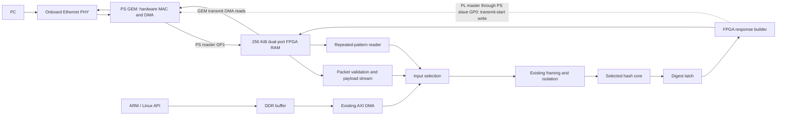

# Ethernet and FPGA RAM inputs

The corrected static image and all four partials pass routed timing, DRC and
full PR compatibility. The board boots the matched bundle, and both new inputs
return correct digests. A physical test also receives the Ethernet digest
while the ARM control process is stopped. Full boundary/bulk acceptance and
the 700-measurement size sweep are recorded separately in the [evidence report](../results/gem-direct-20261116/README.md).
The existing physical TCP
[baseline](../results/ethernet-20261116/README.md) is recorded separately.

The compact and Oxide Quartz SHA3 implementations are unchanged by this input
extension. Both run in the same new static shell at the same clock. Original
Oxide source, the pinned revision and license notices remain in
[THIRD_PARTY_NOTICES.md](../THIRD_PARTY_NOTICES.md). Any resource comparison must
separate the hash partition from the added RAM, interconnect and packet logic.

The new static shell retains the PS APIs, GUI transport, AXI DMA, hash register
ABI, SHA3-256/SHA-256/BLAKE2s-256 engines and DFX interface. It adds two mutually
exclusive sources: a GEM packet receiver and an FPGA block-RAM replay reader.
All sources pass through the existing length framing, isolation and hash core.



## What “direct” means on this board

The Zybo's Ethernet PHY is physically connected to PS MIO, as shown in
[Digilent's manual](https://digilent.com/reference/_media/reference/programmable-logic/zybo-z7/zybo-z7_rm.pdf).
The Zynq-7000 GEM is a hardware controller in the PS. Its DMA masters can reach
PL through the general-purpose AXI master ports; see AMD's
[master/slave connectivity table](https://docs.amd.com/r/en-US/ug585-zynq-7000-SoC-TRM/Connectivity)
and [system bus masters](https://docs.amd.com/r/en-US/ug585-zynq-7000-SoC-TRM/System-Bus-Masters).

Here, both receive descriptors and packet buffers are in FPGA RAM. The FPGA
consumes completed packets and returns their descriptors. It also builds
acknowledgments and digest replies, owns the transmit descriptor, and writes
the GEM transmit-start register through an AXI master. The ARM initializes the
link/session and performs cleanup; it does not copy file payloads, recycle
receive descriptors or construct per-packet replies during the run.

This is different from UltraScale+ devices such as the ZCU102: their GEM exposes
a [direct FIFO interface to PL](https://docs.amd.com/r/en-US/ug1085-zynq-ultrascale-trm/FIFO-Interface-to-PL?contentId=Km0VAVKyNOnyhOwE4_N6LQ)
that can bypass GEM DMA. Zynq-7000 does not expose that packet FIFO interface.
The Zybo path therefore still uses GEM DMA, but removes the Linux receive/copy
and separate DDR-to-PL transfer from file delivery.

Gigabit Ethernet has a raw ceiling of 125 MB/s, with less useful file throughput
after framing overhead. It cannot expose the full approximately 234 MB/s DMA
rate previously measured for the compact SHA3-256 core. FPGA RAM replay is the
separate experiment for sustained throughput without Ethernet or DDR feeding.

## RAM replay

The same 256 KiB block RAM is reused when Ethernet is inactive. The first 4 KiB
holds control/descriptor data; patterns occupy `0x1000..0x3ffff`, at most
258,048 bytes (252 KiB). Pattern length must be a positive multiple of eight;
the total hashed length may be any supported byte count, including zero.
A 128 KiB pattern can be repeated 8,192 times for a 1 GiB message.

Loading the pattern is outside the timed hash. The FPGA wraps the read pointer,
honors core backpressure and marks only the final message beat. The 64-bit RAM
port can supply a beat every two clocks: a theoretical 400 MB/s source at
100 MHz, not a measured hash rate. Software verifies the digest of the exact
repeated pattern, including a partial final repetition if requested.

Replay results must be labeled **repeated FPGA-resident test data**. They are
not a 1 GiB file stored in FPGA RAM or an Ethernet transfer. The device has
140 36-Kibit BRAM blocks, giving 630 KiB raw capacity, approximately 560 KiB with
ordinary 32/64-bit data widths and unused parity bits; the shared shell and DFX
floorplan limit the practical allocation. See [AMD DS190](https://docs.amd.com/v/u/en-US/ds190-Zynq-7000-Overview).

## Packet protocol and ownership

The bounded bring-up protocol uses experimental EtherType `0x88b5` on the local
Ethernet segment, not IP/TCP. The ordinary TCP API remains available before and
after an exclusive hardware run. Static IP configuration is retained.

Data frames contain a 64-byte header and 1–1,440 payload bytes. Bytes 0–13 are
the Ethernet header; bytes 14/15 are version/type `1/1`; bytes 16–19 hold a
session ID, 20–27 the expected byte offset, and 28–31 the payload size. Protocol
integers are little endian. The FPGA accepts only a complete frame of the
declared size, matching session and next contiguous offset. It drops invalid,
duplicate and out-of-order frames without feeding them to the hash core.

The receiver has 32 2-KiB slots. The PC defaults to a window of 12 frames and retries
from the last acknowledged offset after a bounded timeout. The FPGA emits
cumulative acknowledgments about every 50 microseconds. Replies use type 2,
the same session/offset fields, status at bytes 28–31 (0 receiving, 1 digest,
2 error), and digest bytes 32–63. The GEM validates incoming FCS and generates
outgoing FCS. Host digest verification is independent of the returned hardware
digest. This protocol is for the isolated development link, without encryption
or peer authentication.

`gem_send INTERFACE BOARD_MAC SESSION FILE REPORT.json [WINDOW]` accepts a
bounded window of 1–32 frames and records it in the result. Physical tuning
found that 16-frame bursts could overrun the GEM receiver even though the PL
descriptor ring had space. Twelve frames delivered 56.46 MB/s in a 16 MiB
probe with no retransmissions or receive overruns; eight frames delivered
39.92 MB/s. These probes select a conservative default, not a line-rate claim
or a repeated 1 GiB comparison. [Raw tuning evidence](../results/gem-direct-20261116/sender-tuning.json).

The data retry timer starts at the first valid readiness ACK. Link startup
must not immediately expire a newly sent data window. The host regression
delays readiness, repeats the initial ACK, and intentionally drops a data
frame; the old timer fails that regression.

The Ethernet transfer timer starts with the first data send and ends at the
digest reply. Empty input has no data send, so its transfer timer is reported
as zero; that is not an empty-message hash-latency measurement. FPGA replay
uses the hardware START-to-digest cycle counter instead. Neither timing method
includes software reference hashing.

Hash abort/DFX reset and AXI transaction reset are separate: an outstanding
transmit-start write finishes even if the hash is aborted. Only the global AXI
reset resets the AXI master. This avoids dropping one half of a split AXI write.

## Address map and tools

| Address | Function |
| --- | --- |
| `0x43c00000`, 4 KiB | Existing hash control/status/digest ABI |
| `0x40400000`, 64 KiB | Existing AXI DMA |
| `0x80000000`, 256 KiB | New FPGA RAM through PS master GP1 |
| RAM `+0x000` | 32 receive descriptors |
| RAM `+0x200` | One wrapping transmit descriptor |
| RAM `+0x400..0x41f` | Mode, session/pattern length, message length, peer/local MAC |
| RAM `+0x500..0x510` | Accepted count, packet count, signature and result status |
| RAM `+0x800` | FPGA-built 64-byte reply |
| RAM `+0x1000` | Packet buffers or replay pattern |

## Rebuild and reproduce

Run from the repository root with Vivado 2024.2 and the matching Buildroot ARM
compiler available. The original build directory and deployed profile are not
changed by these commands:

```sh
./scripts/test_gem_ingress.sh
./scripts/build_hash_io_tools.sh
sudo python3 software/net/test_sender.py build/gem-direct/gem_send
./scripts/build_gem_direct.sh
```

The ingress test models BRAM, descriptors, backpressure and AXI transactions in
Verilator. The sender test uses a temporary host veth pair and a software
reference peer. Neither is a physical FPGA test. The normal `./test.sh` also
includes the ingress RTL simulation and all existing engine/API checks.

Static synthesis also runs `scripts/test_generated_bram.sh` with Vivado's
simulator against the **generated memory netlist**. It exercises all eight
byte-enable lanes and cross-port readback at the descriptor, reply, pattern and
last RAM addresses. This catches IP wiring errors that a behavioral RAM model
cannot. Both memory ports and their interface metadata are 64 bits; the AXI
interconnect adapts GP1's 32-bit transactions. The first image's inconsistent
port metadata silently tied four write enables low, even though ingress-only
simulation passed. The generated-memory regression reproduces that failure.

The FPGA flow may reuse unchanged OOC hash checkpoints only after checking the
checkpoint and every recorded source hash. It implements compact, Quartz,
SHA-256 and BLAKE2s against one static placement/routing, checks setup, hold,
pulse width, route completion and DRC, then performs full `pr_verify` checks.
No programming images are published until all configurations pass.
`build/gem-direct/ACCEPTED.sha256` seals the inputs, checkpoints, images and
reports; changing a recorded static source invalidates that seal.

The recorded Quartz implementation needed an additional physical optimization
of its 1,088-load buffer-enable net. If the initial flow stops at that diagnosed
timing failure after compact has passed, these explicit continuation stages
retain compact and the locked static checkpoint, repair Quartz routing, then
implement SHA-256/BLAKE2s and run the complete publication gates:

```sh
./scripts/build_gem_direct.sh oxide-fanout
./scripts/build_gem_direct.sh finish
```

The repair uses an additional post-route physical-optimization pass and retains
its routing when complete. It does not edit Quartz RTL, change its buffer mode
or lower the clock. Its
input/output checkpoints and script are checksummed separately. This continuation
is specific to the recorded net and refuses a changed source set or missing net.

`software/net/package.py` requires this seal and the accepted shared-card base
DTB. It stages a matching full bitstream, DTB, all four partials, runtime and
checksum inventory into a fresh directory and tarball. Generated artifacts are
not committed. The base DTB SHA is pinned in the packager; a source-only clone
must obtain that accepted shared-card artifact before packaging. Do not replace
it with an unrelated DTB just to pass packaging.

Upload the tarball through the existing checksum-verifying UART uploader. On
the board, extract it to a fresh directory and run its `install.py` with a fresh
backup directory and `--expected-current-static` equal to the currently checked
full-image SHA. The installer checks the bundle, saves the existing boot pair
and runtime, keeps old firmware files, and verifies every installed file.
It leaves `profile.env`, other profiles, the kernel and the bootloader intact.
Its saved `rollback.py` restores the prior boot pair and runtime; either install
or rollback requires a reboot to load the selected full image.

The installed BusyBox `tar` lacks its `-z` option. Use the board's Python
`tarfile` module to extract the checksum-verified archive instead of `tar -xzf`.

After boot identity and the ordinary PS service have been checked, run the
bounded physical smoke test from the PC:

```sh
python3 benchmarks/sha3_profile/compare_inputs.py \
  --output build/gem-direct/physical-smoke \
  --file-1gib build/ethernet-20261116/random-1gib.txt --smoke-only
```

Omit `--smoke-only` and use another fresh output directory for algorithm
boundaries, multi-buffer inputs and three interleaved 1 GiB trials per SHA3
implementation and input mode. The script independently computes expected
digests. It uses the original random-text file for bulk Ethernet and a specified
128 KiB repeated pattern for bulk replay. It forces an intermediate algorithm
before each partial, checks the returned ID and image hash, and verifies recovery
to compact and the ordinary PS API after each run. The original upstream Quartz
interface cannot express an empty message, so that case is excluded for Quartz.

If UART console output interrupts an encoded log record, the harness retries
the read at most three times and requires a complete record with valid gzip
length and CRC. It never removes arbitrary console text from evidence. A
failed complete acceptance run can be continued with the same command and
`--resume`; keep `--mode all` and omit `--smoke-only`. Completed case definitions,
pattern and sender hashes, network identity, and static identity must still
match. The previous report and continuation source hashes are retained, and
retried cases use new artifact names. A changed sender or image requires a
fresh output directory.

An additional packet test stops the userspace hardware-control process with
`SIGSTOP` after initialization. The PC must receive the verified digest while
that process is still stopped, before it is resumed for cleanup. This checks
that even its status-poll loop is unnecessary for payload processing and replies;
it does not claim that the ARM processors or the Linux kernel are powered off.

The physical test defaults to the current bench's `enp3s0` interface; use
`--interface` to select another. It discovers both MAC addresses at run time,
including the board's current address after a reboot. Standard TCP and
raw packet tests are distinct; the raw protocol does not use the static IP
address. There is only one accelerator owner at a time.

`scripts/build_gem_direct.sh` creates a separate static build and all four
compatible configurations under `build/gem-direct`. It reuses unchanged OOC
hash checkpoints only after checking both DCP and source hashes; otherwise it
synthesizes the same sources. Timing, route, DRC and full `pr_verify` checks
precede bitstream publication. Old partials are incompatible with the new static
image and remain in their original firmware namespace.

`software/net/package.py` stages a matching full image, DTB, manifest, partials,
runtime and checksum inventory. It does not deploy or change the active demo
manifest. `board_run.py` validates the running DT's static identity, selects the
requested physical core, stops the shared API and takes exclusive hardware
ownership. In Ethernet mode Linux's `eth0` is temporarily down while GEM is
controlled by the FPGA; the wrapper restores the interface, compact core and
ordinary API afterward. The privileged bounded C utility initializes hardware
and observes results. Do not run it alongside another accelerator owner.

The original GUI continues to use `LocalHasher` and the PS DMA path. Its active
image identities are in `demo/board_manifest.json` and `demo/core_variants.json`;
dated benchmark manifests remain immutable evidence.

## Verification categories

- `scripts/test_gem_ingress.sh`: RTL simulation of packet filtering, ring wrap,
  random stalls, stream stability, final keeps, replay wrapping and AXI completion
  after a hash abort. These are not physical results.
- `software/net/test_sender.py`: host-only veth protocol test, including an
  intentionally dropped frame and retransmission. No FPGA is involved.
- Existing software and GUI tests: regression checks for the retained APIs.
- Physical deployment: corrected bundle booted and identity/persistence verified;
  see the dated evidence for 84 input cases, 81 PS API checks, GUI/TCP regressions
  and the full size sweep.

The SHA3 comparison retains the unchanged, pinned Oxide Quartz core and its
full-rate byte adapter. Credit, licensing and integration limits remain in
[THIRD_PARTY_NOTICES.md](../THIRD_PARTY_NOTICES.md). Shared Ethernet/RAM logic is
separate from hash-partition resource comparisons.

## Repeated size sweep

`benchmarks/sha3_profile/sweep_inputs.py` compares both SHA3-256 implementations
at every power of two from 64 bytes through 1 GiB: 25 sizes, seven timed trials
per core and mode, and one full warmup round. That is 700 timed measurements
plus 100 warmups across FPGA replay and raw Ethernet. The two intervals remain
separate; the Ethernet curve is not a pure-core throughput curve.

Both modes use identical deterministic bytes: a 128 KiB pattern with byte `i`
equal to `(i*131 + (i >> 8)) & 255`, repeated or truncated to the requested size.
The independent PC SHA3 reference is computed before measurement. No 1 GiB file
is sent over UART or stored in FPGA RAM. Ethernet reads generated local files;
the board generates only the small replay pattern.

```sh
python3 benchmarks/sha3_profile/sweep_inputs.py \
  --output results/gem-direct-20261116/sweep-64B-1GiB \
  --data build/gem-direct/sweep-data

build/profile-plot-venv/bin/python benchmarks/sha3_profile/plot_size_sweep.py \
  results/gem-direct-20261116/sweep-64B-1GiB
```

Use a fresh output directory for a new run. `--max-power 7 --repetitions 1`
provides a small physical pilot. The full sweep can resume completed batches
with `--resume` only when the recorded scripts, sender, network and settings
still match. The plotting command requires matplotlib; the measurement and
summary-validation code use the standard library. This bench workflow also
uses the installed checksum-verifying Zybo UART uploader.

Each batch selects and verifies a physical core once, then tests all 25 sizes
in ascending order. Core order alternates between rounds. Reconfiguration,
pattern loading/readback and reference hashing are outside the timers. The
accepted C helper starts a new hardware hash for every size; its FPGA counter
still includes framing, input-reader stalls and finalization. It is not an
isolated Keccak-permutation measurement. Each batch restores compact and
verifies a real PS DMA recovery hash. Ethernet session IDs separate consecutive
transfers, and the FPGA repeats the final reply before resetting the session.

Raw JSON retains all warmups, counters, partial-image identities, input digests,
sender retries and board logs. `samples.csv` includes every observation;
`summary.csv` reports the measured medians and ranges. The speedup line divides
Quartz's median time by compact's median time. Its shaded range uses ratios
from corresponding measured rounds, rather than an invented confidence bound.
Throughput bands are observed minimum and maximum rates. One board, seven
samples and no affinity or thermal control do not establish general reliability
or a universal latency improvement.
