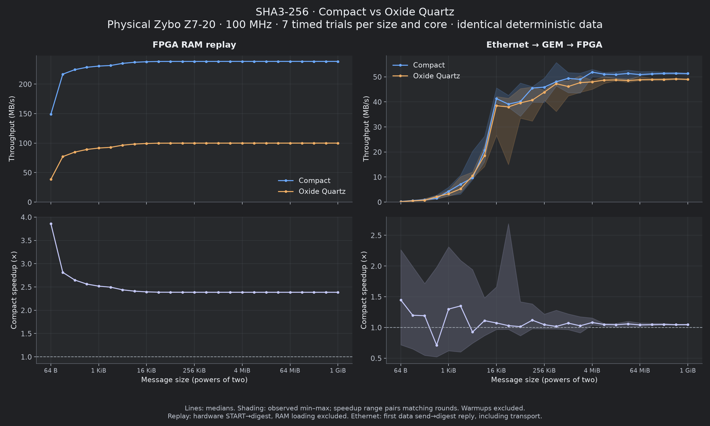

# Physical SHA3-256 size sweep

**Pass: 700 timed measurements plus 100 warmups. Every digest matched the
independent software reference.** This is a physical Zybo Z7-20 run at 100 MHz,
not simulation or QEMU.

Both compact and unchanged Oxide Quartz hash every power-of-two message size
from 64 bytes through 1 GiB: 25 sizes, seven timed repetitions per core and
input mode. A complete warmup round is excluded in advance. All measured
samples are retained, including Ethernet retries. Core order alternates
between rounds. The [plan](plan.json) records exact input digests, source and
binary hashes, sessions, clock and timing definitions.

| Input / message size | Quartz MB/s | Compact MB/s | Compact speedup |
| --- | ---: | ---: | ---: |
| FPGA replay / 64 B | 38.554 | 148.837 | 3.860× |
| FPGA replay / 1 KiB | 91.592 | 230.631 | 2.518× |
| FPGA replay / 1 MiB | 99.986 | 238.583 | 2.386× |
| FPGA replay / 1 GiB | 100.000 | 238.596 | 2.386× |
| Ethernet / 64 B | 0.155 | 0.225 | 1.449× |
| Ethernet / 1 KiB | 3.303 | 4.291 | 1.299× |
| Ethernet / 1 MiB | 46.131 | 49.391 | 1.071× |
| Ethernet / 1 GiB | 49.014 | 51.339 | 1.047× |

At 1 GiB, FPGA replay takes **10.737419 s
for Quartz and 4.500242 s for compact**.
The Ethernet medians are **21.906800 s
and 20.914848 s**, respectively.
MB/s uses decimal bytes; the size axis uses binary powers of two.

## What the two curves measure

- **FPGA RAM replay:** hardware START through digest completion, including the
  FPGA input reader, framing and finalization. Pattern loading and readback,
  reconfiguration and reference hashing are outside the interval. It is a
  complete hardware-fed hash operation, not isolated Keccak-round latency.
- **Ethernet:** PC first data send through receipt of the FPGA digest reply.
  This includes the stream's file access, packet delivery and acknowledgments.
  File open/mapping, first-window preparation and session/link setup precede
  the timer. It is not complete application/request latency. The PS GEM DMA
  writes FPGA RAM, while FPGA logic consumes payloads and builds replies.

Both modes use the same 128 KiB deterministic byte pattern, repeated or
truncated to each size. Byte i within the pattern is
`(i*131 + (i >> 8)) & 255`. Larger inputs extend the same prefix. Only the
small pattern resides in FPGA RAM; a 1 GiB file is not stored there. No bulk
input is transferred over UART. Ethernet input files are generated locally on
the PC and are warmed by preparation/reference verification, so these are not
cold-storage benchmarks.

Every replay size/core pair returned identical hardware cycle counts across
all seven measured trials. Ethernet varies with host/transport behavior, and
its much smaller speedup shows that the core is not the only determinant of
delivered throughput. The dominant transport bottleneck has not been isolated.
The earlier random-text comparison and TCP baseline use different intervals;
their results remain separate in the [parent report](../README.md).

Lines show medians. Throughput shading shows observed minimum and maximum
rates. The speedup line divides Quartz's median time by compact's median time;
its range pairs corresponding measured rounds. These are observed ranges,
not confidence intervals. One board and seven trials, without CPU affinity or
thermal control, do not establish universal latency or reliability claims.

## Data and reproduction

- [All samples, including warmups, as CSV](samples.csv)
- [Per-size medians and ranges as CSV](summary.csv)
- [Raw measured results](results.json) and [computed summary](summary.json)
- [Latency chart](latency.png), [editable throughput SVG](throughput-and-speedup.svg), and [latency SVG](latency.svg)
- [Chart software/input/output hashes](chart-provenance.json)

Each batch's adjacent JSON/logs retain selected partial identity, actual DFX
load time, hardware events, returned digest, and verified PS DMA recovery.
Client files retain every Ethernet timer and retry count. The accepted static
identity is `6102e03f31c175d8cba562a7be0fbf17e8890349f909713e8231cf20ce87987b`.

See the [measurement guide](../../../docs/gem-direct.md#repeated-size-sweep)
for commands. The plotting script rejects missing/duplicate samples, digest
mismatches and summary timings that disagree with recorded counters. Copy this
directory before regenerating charts to preserve the retained evidence seal.

Credit to [Oxide Computer Company and the Quartz contributors](../../../THIRD_PARTY_NOTICES.md)
for the pinned byte-stream SHA3 reference and prior work. This is a Zynq
integration comparison, not a benchmark of Oxide's production SPI-NOR system.
The [parent resource table](../README.md) reports the matched routed partition
counts: 21.90% fewer LUTs and 57.98% fewer FFs for compact.
