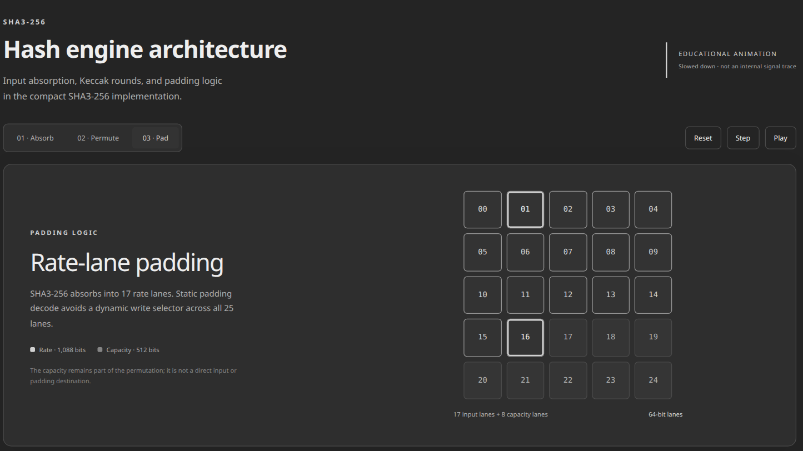
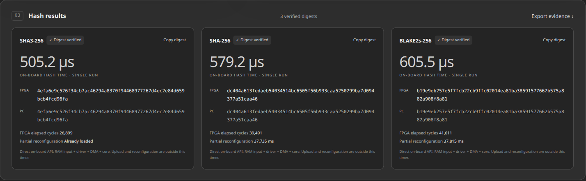

# Hash Lab tutorial

Follow one 8 KiB file from the PC to three FPGA digests. You can launch the dashboard, explore the datapath and verify the recorded answers on an Ubuntu PC. A Zybo Z7-20 with the matching hash configuration lets you repeat the experiment on hardware and export your own measurements.

## Open the dashboard

From a terminal on Ubuntu 24.04 with Git, Python 3.11 or later and a browser, clone the repository and start Hash Lab.

```sh
git clone https://github.com/rlongwell/fpga-dfx-hash-accelerator-public.git
cd fpga-dfx-hash-accelerator-public
./dashboard.sh
```

If you already have a checkout, run the last command from its root. Keep that terminal open. The launcher opens Hash Lab at `http://127.0.0.1:8765`. The dashboard uses the Python standard library. Vivado is needed only for FPGA builds.

1. In **Live bench**, choose **Use an 8.2 kB sample**. The file card shows 8,192 bytes rounded to decimal kB. Select **Run all three engines** to prepare one input for SHA3-256, SHA-256 and BLAKE2s-256.
2. Open **Inside the FPGA → Pad**. SHA3-256 accepts input in blocks of 136 bytes. The diagram splits its state into 25 lanes of eight bytes each. The first 17 lanes accept input and padding. The other eight take part in the permutation. Use **Step** to advance one frame. The colors illustrate the operation.
3. Open **Measured results**. Switch between **DMA** and **PS API** to see how the measured throughput changes when software work is included. These are saved measurements from a physical board. You can browse both views with the board disconnected.



## Check the recorded digests on your PC

The small sample repeats the byte values 0 through 255 exactly 32 times. In a second terminal at the repository root, recompute its three digests and compare them with the FPGA receipt.

```sh
python3 - <<'PY'
import hashlib
import json
from pathlib import Path

sample = bytes(range(256)) * 32
receipt = json.loads(Path("results/demo-20261115/gui-sample.json").read_text())
algorithms = {"sha3": hashlib.sha3_256, "sha256": hashlib.sha256, "blake2s": hashlib.blake2s}
rows = receipt["results"]
assert receipt["state"] == "passed" and receipt["file"]["size"] == len(sample)
assert [row["algorithm"] for row in rows] == list(algorithms)
for row in rows:
    name = row["algorithm"]
    expected = algorithms[name](sample).hexdigest()
    assert row["digest"] == row["reference_digest"] == expected, name
    print(f"{name:7}  {expected}  MATCH")
PY
```

You should see three `MATCH` lines. The SHA-256 digest starts with `dc404a61`. Each algorithm has its own expected value. This check reproduces the reference calculation. The cycle counts and durations in the receipt came from the original board run. [Inspect the original JSON](results/demo-20261115/gui-sample.json)



## Run the sample on a Zybo

**What you need.** The live dashboard expects a Zybo Z7-20 booted into the supported `hash` profile with its driver, running hash service and the full and partial images identified by the dashboard manifest. On a new board, the base build guide covers building and booting the three-engine system and testing it with the TCP client. The dashboard and replay extension use a separately validated configuration. A fresh checkout includes source and measurements. Generated images and the original locked checkpoints are separate build artifacts. [Base board bring-up](docs/loading.md) · [Dashboard manifest](demo/board_manifest.json) · [Dashboard and replay build requirements](docs/gem-direct.md#rebuild-and-reproduce)

1. In **Live bench**, select **Wired SSH** or **Wi-Fi SSH** with the board powered and reachable. The dashboard uses the existing `zybo-wired` or `zybo-wifi` SSH alias, key authentication and a pinned host key. **USB UART** uses the J12 USB connection and the port configured for the reference board. Close any terminal using that port. [Connection details and troubleshooting](docs/demo.md#connection-troubleshooting)
2. Choose **Check board**. Wait for **Board verified**. The check compares the boot profile, kernel, installed image manifest and software with the dashboard's expected configuration.
3. Choose **Use an 8.2 kB sample**, enable **Run all three engines**, and choose **Hash on the FPGA**. The board checks the uploaded bytes against the checksum from the PC. The board hashes the bytes, switches engines between requests, then restores compact SHA3 and restarts its service.
4. In **Hash results**, look for three **Digest verified** cards. Compare the FPGA and PC lines within each card. **Already loaded** means the request reused the engine that was in the partition. The other cards show how long FPGA Manager took to load the next image.
5. Choose **Export evidence**. In the downloaded JSON, inspect `file.size`, then each result’s `algorithm`, `digest`, `reference_digest`, `core_cycles` and `manager_load_ns`. Your sample digests should match the recorded ones exactly. Timings can vary by run.

## Try a file that crosses a DMA boundary

On the PC, create a file 17 bytes larger than the board’s 1 MiB DMA buffer. The byte pattern matches the retained boundary test.

```sh
python3 - <<'PY'
from pathlib import Path
block = bytes(range(256))
Path("hash-lab-boundary.bin").write_bytes(block * 4096 + block[:17])
PY
```

In **Live bench**, drop `hash-lab-boundary.bin` into the file box and repeat the three-engine run. Expect one digest per algorithm. In the exported JSON, each result should have `length` equal to **1,048,593** and `dma_transfers` equal to **2**. The first transfer fills the buffer. The second carries the final 17 bytes. The shell uses the declared length to mark the end of the file, so the engine preserves its state between transfers.

To check this behavior without a board, open the saved acceptance run and find the job with that file size. The same report includes a zero-byte input that completes with zero DMA transfers. [Boundary-test receipts](results/demo-20261115/physical-acceptance.json) · [Framing at the partition interface](docs/architecture.md#static-framing-and-dma)

## Where to go next

- **Use the engine from an application.** Hash a Python byte buffer on the ARM processor or pipe text into the CLI. [Local hashing examples](docs/local-ps.md)
- **Measure the hardware datapath.** Run a replay sweep on the configured board and read the median throughput by input size. [Replay guide](docs/demo.md#physical-fpga-memory-replay-sweep)
- **Check the implementation.** Install the simulator prerequisites and run the offline suite, or build the base DFX images with Vivado 2024.2. [Build and test](docs/build.md) · [Verification results](results/status.md)

Stop the dashboard with **Ctrl+C** in the launcher terminal when you are finished. [Back to the project overview](README.md)
